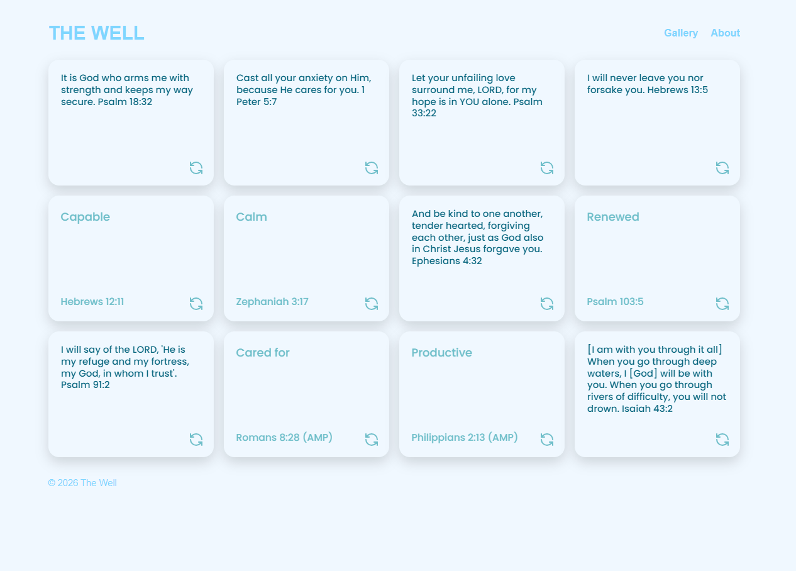
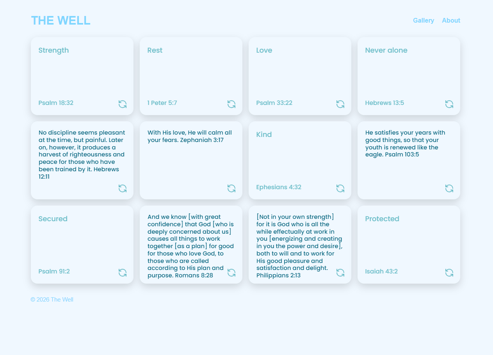

# The Well

**The Well** is a scripture memorization web application developed as an independent front-end practice project, inspired by the Flashcard App project.

The application displays a collection of 12 interactice cards, each featuring a keyword, scripture reference, and corresponding Bible verse. Users can flip the cards to reveal the verses and practice memorizing the verses.

## Features

- A gallery of 12 scripture memorization cards
- Interactive cards with front and back views
- Card-flipping functionality
- A four-column, three-row CSS Grid layout
- A centered desktop layout
- Navigation between application views (Forthcoming)
- Responsive mobile layout (Forthcoming)

## Technologies

- HTML5
- CSS3
- JavaScript
- CSS Grid and Flexbox
- DOM Manipulation

## Screenshots

#### Home Page

#### Card Interactions: Click the "Flip" button to see the verse on the back of the card.

## Development Notes

This project is an ongoing exercise in front-end development, with particular attention to:

- Building layouts with CSS Grid
- Centering and aligning page containers
- Managing viewport height and eliminating unnecessary scrolling
- Refining card dimensions, typography, and spacing
- Creating interactive components with JavaScript
- Practicing client-side navigation

Recent layout improvements include reducing card dimensions, adjusting typography, and refining header spacing to fit the entire 12-card gallery within the desktop viewport.

## Future Development

Planned features include:

- A form for creating personalized sets of 12 scripture cards
- Custom card color selection
- Gallery page for viewing previous sets
- Navigation between saved collections

## Project Status

**Work in progress -- experimental front-end application**

### Live Preview

The Well is maintained as a standalone project and is currently in development. The layout is optimized for desktop viewing, with responsive updates forthcoming.

[View The Well -- Live Desktop Preview](https://kristineservia.github.io/the-well/)
